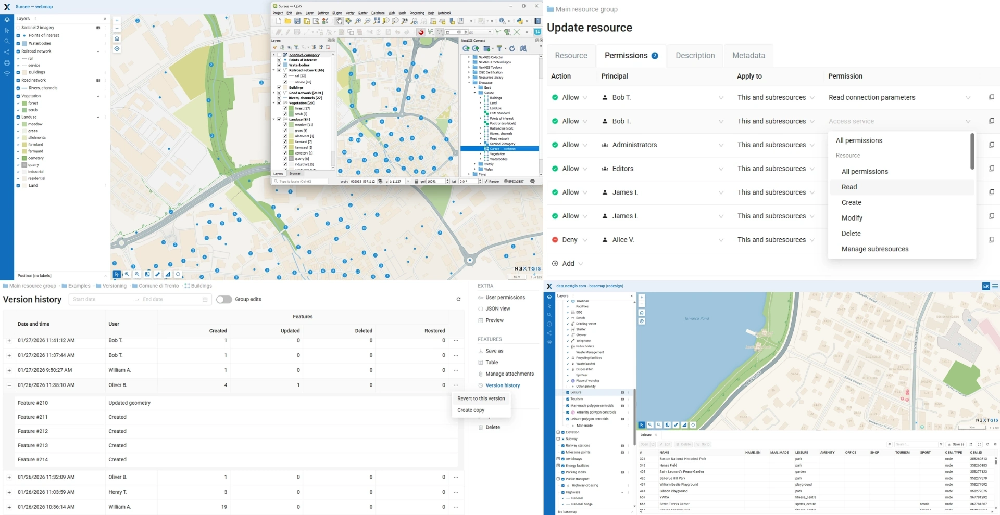

# NextGIS Web Community Edition

Official Docker-based setup for running NextGIS Web Community Edition.

This repository is intended for users and developers who want to launch a self-hosted [NextGIS Web](https://github.com/nextgis/nextgisweb) instance with Docker.


## Table of contents

- [What is NextGIS Web](#what-is-nextgis-web)
- [Quick start with plain Docker](#quick-start-with-plain-docker)
- [Docker Compose](#docker-compose)
  - [Installation](#installation)
  - [Configuration](#configuration)
  - [NextGIS Web CLI](#nextgis-web-cli)
  - [Reverse proxy configuration](#reverse-proxy-configuration)
  - [Uninstalling](#uninstalling)
- [Repository overview](#repository-overview)
- [Building images from sources](#building-images-from-sources)
- [Commercial support](#commercial-support)
- [Community and ecosystem](#community-and-ecosystem)

## What is NextGIS Web

**NextGIS Web** is an open-source Web GIS server for **geospatial data management**, **web map publishing**, and **QGIS-centered collaborative workflows**.

It combines a powerful spatial backend, a web-based interface for administration and map publishing, and a full REST API. Suitable for projects ranging from small teams to enterprise-grade GIS infrastructures.

For the core application detailed description and source code, see the main repository: [nextgis/nextgisweb](https://github.com/nextgis/nextgisweb).



## Quick start with plain Docker

Using a plain Docker container is the easiest way to get NextGIS Web CE up and running. It is suitable for testing and experimentation, but Docker Compose (see below) is recommended for continuous use. Assuming Docker is installed and running on your machine, run the following command to start NextGIS Web CE in a named container with a persistent volume (`26.10.0` is the current version):

```bash
docker run --name ngw_ce -dp 8080:8080 -v ngw_ce:/opt/crater/data nextgis/nextgisweb-ce:26.10.0 server
```

Wait a few moments, then you can access your Web GIS:

- URL: [`http://localhost:8080`](http://localhost:8080)
- Login: `administrator`
- Password: `admin`

If you encounter any issues, check the logs with:

```bash
docker logs ngw_ce
```

To remove the container and all data, run the following commands:

> [!CAUTION]
>
> This will remove all NextGIS Web data, so make sure you no longer need it or have a backup before proceeding.

```bash
docker rm --force ngw_ce
docker volume rm ngw_ce
```

## Docker Compose

Docker Compose is recommended for continuous use of NextGIS Web CE. It simplifies container and volume management and makes updates and maintenance easier.

### Installation

You must have Docker Compose 2.x installed on your machine. For simplicity, this guide assumes you are running everything from a root shell (`sudo -i` for example). So, first create a directory for the stack, for example `/srv/ngw_ce`:

```bash
mkdir /srv/ngw_ce
cd /srv/ngw_ce
```

Create the `/srv/ngw_ce/.env` file with the following contents, where `26.10.0` is the current version:

```text
IMAGE_VERSION=26.10.0
```

Then create `/srv/ngw_ce/docker-compose.yaml`:

```yaml
services:
  app:
    image: nextgis/nextgisweb-ce:$IMAGE_VERSION
    command: server
    environment:
      NEXTGISWEB__CORE__LOCALE__DEFAULT: "en"
    ports:
      - 8080:8080
    volumes:
      - data:/opt/crater/data
      - backup:/opt/crater/backup
    restart: unless-stopped
volumes:
  data:
  backup:
```

Start the stack with the following command:

```bash
docker compose up -d
```

Wait until the stack starts, then open [`http://localhost:8080`](http://localhost:8080) in your browser and log in with `administrator` / `admin`.

If you encounter any issues, check the logs with:

```bash
docker compose logs
```

### Configuration

Environment variables are the recommended way to configure NextGIS Web. You can add them to the `environment` section of the `app` service in the `docker-compose.yaml` file. The list of available environment variables can be obtained by running the following command:

```bash
docker compose run --rm app nextgisweb-config --env-vars
```

After making changes to the `docker-compose.yaml` file, apply them with the following command:

```bash
docker compose up -d
```

### NextGIS Web CLI

To execute NextGIS Web CLI commands inside the container, use `docker exec app nextgisweb` followed by the command you want to run. For example, to run maintenance tasks, you can use:

```bash
docker compose exec app nextgisweb maintenance
```

### Reverse proxy configuration

It is recommended to run NextGIS Web CE behind a reverse proxy that handles TLS termination. The most common choice is Nginx, the configuration template for which is provided below.

<details>

<summary>Nginx configuration template</summary>

```nginx
# $http_upgrade variable must be set in the root block of the http,
# see https://nginx.org/en/docs/http/websocket.html
map $http_upgrade $proxy_connection {
    default upgrade;
    ''      close;
}

server {
    server_name ngw.example.com;

    # Server directives: listen, ssl_* etc

    location / {
        client_max_body_size 0;
        proxy_read_timeout 3600s;

        proxy_http_version 1.1;
        proxy_pass http://localhost:8080;
        proxy_set_header Host $http_host;
        proxy_set_header Upgrade $http_upgrade;
        proxy_set_header Connection $proxy_connection;
        proxy_set_header X-Forwarded-Proto $scheme;
        proxy_set_header X-Forwarded-For $remote_addr;
    }
}
```

</details>

### Uninstalling

> [!CAUTION]
>
> The following commands will remove all NextGIS Web data. Make sure you no longer need it or have a backup before running them.

```bash
docker compose down --volumes --remove-orphans
```

## Repository overview

Here is a brief overview of the repository structure:

- `package` - submodules with NextGIS Web core package and extensions
- `build` - Docker build context skeleton
- `crater` - submodule with NextGIS Dockerfile generation toolkit

> [!NOTE]
>
> The `crater` submodule points to a private repository, as it is tightly coupled with NextGIS internal infrastructure. You don't need access to it to build or run NextGIS Web CE. Everything you need to build the image is vendored in the `build` directory.

## Building images from sources

To build the NextGIS Web CE image from sources you need to have [Just](https://github.com/casey/just) installed on your Linux machine. Then run the following commands:

```bash
git clone git@github.com:nextgis/nextgisweb_ce.git
cd nextgisweb_ce
just build
```

After that, you can run the container as described in the "Quick start with plain Docker" section, using `nextgisweb-ce` as the image name.

## Commercial support

Professional support, cloud and enterprise deployments, and consulting services are available from the NextGIS team.

☁️ [Ready-to-go cloud](https://nextgis.com/pricing-base/)

🏢 [Professional on-premise deployment](https://nextgis.com/pricing/)

🌍 [NextGIS Website](https://nextgis.com)  

✉️ [Contact us](https://nextgis.com/contact/)

## Community and ecosystem

💬 [NextGIS community forum](https://community.nextgis.com)

🐞 [GitHub issues and discussions](https://github.com/nextgis/nextgisweb/issues)

🎨 [Frontend libraries](https://github.com/nextgis/nextgisweb_frontend)

🧩 [NextGIS Web - main repository](https://github.com/nextgis/nextgisweb)

🧩 [NextGIS Connect - QGIS integration plugin](https://github.com/nextgis/nextgis_connect)

🧩 [NextGIS Mobile - integrated Android application](https://github.com/nextgis/nextgis_mobile_android)
